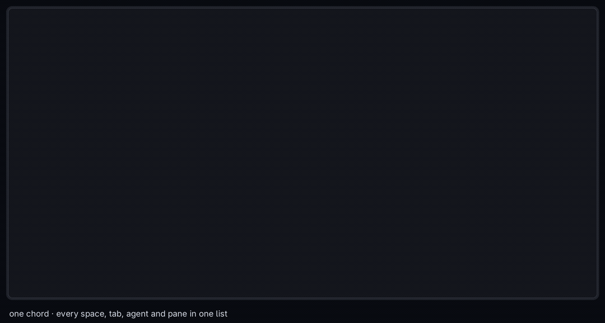

# herdr-command-plugin

[](https://github.com/adhikasp/herdr-command-plugin/actions/workflows/ci.yml)

**Cmd+K for [Herdr](https://herdr.dev): jump anywhere, run anything.**



A dozen agents across five spaces gets hard to keep track of. Press one key and
your whole session becomes a single fuzzy list: every space, tab, agent, named
pane and command. Type a few letters, hit Enter, you're there. Think Raycast,
the Slack quick switcher or VS Code's Cmd+P, for a terminal full of agents.

## Why you'll like it

- **One search for everything.** Places and commands share one list, so you
  never have to remember where something lives.
- **Narrow it with one letter.** `s pilf` finds the `pi-life` space, `a codex`
  your Codex agents. If a prefix matches nothing, it just searches everything.
- **A real command palette.** `>` lists herdr's own actions (split, zoom, close,
  focus, new tab or workspace, reload config) and every installed plugin's
  actions, each with its keybinding. Enter runs it.
- **Agents at a glance.** Vendor logos, live status that updates while the bar
  is open (`◉` needs you, `◐` working, `●` done and unread), and a live preview
  of the selected pane.
- **Unread first.** Agents waiting on you and agents that finished since you
  last looked open at the top, then the places you were just in. Quiet rows stay
  quiet: no checkmark where there is nothing new.
- **Tabs that name themselves.** Unnamed Claude and Codex tabs take the name of
  the task the agent is working on. Names you chose are never overwritten.
  Optionally, show each agent's status right in the tab bar.
- **Tidy as you go.** Rename a tab (`ctrl+r`) or close it (`⌦`) straight from
  the list.
- **Small and instant.** One native Rust binary, about 10 ms per keystroke on a
  2,000-row session. macOS, Linux and Windows.

## Install

Needs herdr 0.9 or newer.

```bash
herdr plugin install adhikasp/herdr-command-plugin
```

Herdr doesn't add keybindings for you, so bind one in your herdr `config.toml`:

```toml
[[keys.command]]
key = "prefix+k"
type = "plugin_action"
command = "herdr-command-plugin.open"
description = "command bar"
```

Run `herdr server reload-config`, then press `ctrl+b k`. Want the physical
Cmd+K? [Here's how](docs/reference.md#making-it-a-real-cmdk).

## Day-one cheat sheet

| Type | To |
| --- | --- |
| a few letters | search everything |
| `s ` `a ` `t ` `p ` before a search | only spaces / agents / tabs / named panes (`s:pilf` works too) |
| `>` or `c ` | commands only |
| `enter` | jump there, or run the command |
| `esc` | close, change nothing |
| `ctrl+r` | rename the selected tab |
| `⌦` | close the selected tab (asks first) |

## Make it yours

Prefer vim keys? Set `"modal": true` and the bar opens as a `j`/`k` list where
typing anything else starts a search. Install the Herdr Agent Icons Max font for
vendor logos, or turn on `"tab_status"` for status glyphs in the tab bar.
Every key, option and behaviour is in the **[full reference](docs/reference.md)**.

## Goes well with

[herdr-newtab-plus](https://github.com/jeffarese/herdr-newtab-plus) is the other
half of the loop: this bar jumps to the tabs you have, that one opens the tabs
you don't have yet.

## Credits

herdr-command-plugin grew out of Jeff Arese's
[herdr-bar](https://github.com/jeffarese/herdr-bar) (MIT), which built the bar,
the tab titles and the agent icons. The command palette, everything-search with
kind prefixes, and modal mode are new here.

## License

MIT. See [LICENSE](LICENSE).
